# Invernadero Inteligente IoT con Motor ARM64 de Decisión y Análisis Histórico
## Proyecto 2 — Fase 2

**Universidad de San Carlos de Guatemala**  
Facultad de Ingeniería 
Ingeniería en Ciencias y Sistemas  
Curso: Arquitectura de Equipos y Comunicación 1 (AEYC1) 


| Nombre                       | Carnet    |
| ---------------------------- | --------- |
| Dina Rebeca Pérez Bátres     | 202308200 |
| Ángel José Cárdenas Pocon    | 202304063 |
| Oliverio Abraham Caal Artola | 202303864 |
| Astrid Vanesa Kim Ortiz      | 202300685 |
| Tulio Jafeth Pirir Schuman   | 201700698 |

---

## 1. Introducción

El presente documento corresponde a la Fase 2 del Proyecto de Arquitectura de Computadores y Ensambladores 1, del segundo semestre 2026.

Esta segunda fase amplía el sistema de Invernadero Inteligente IoT desarrollado en la Fase 1, incorporando un motor de decisión en tiempo real implementado en lenguaje ensamblador ARM64, un módulo de análisis histórico de datos de sensores, visualización avanzada mediante Grafana, y un dashboard web desplegado públicamente con autenticación.

El sistema integra tecnologías de hardware embebido, protocolos de comunicación IoT (MQTT), bases de datos en la nube (MongoDB Atlas), programación de bajo nivel (ARM64 Assembly) y herramientas de visualización modernas, con el objetivo de simular un entorno de producción agrícola inteligente capaz de tomar decisiones automatizadas basadas en el estado actual y el historial de lecturas de sus sensores.


---

## 2. Objetivos

### 2.1 Objetivo General

Ampliar el sistema de Invernadero Inteligente IoT de Fase 1 mediante la implementación de un motor de decisión ARM64 en tiempo real y un analizador histórico de datos de sensores, integrando visualización con Grafana y un dashboard web con acceso público, para relacionar programación de bajo nivel, sistemas embebidos, análisis de datos y despliegue de aplicaciones web.

### 2.2 Objetivos Específicos

- Implementar un motor de decisión ARM64 en vivo que reciba lecturas de sensores vía stdin desde Python, calcule indicadores, tome decisiones automatizadas y retorne resultados vía stdout.
- Desarrollar un analizador histórico en ARM64 que procese archivos CSV de cantidad variable de filas, calculando RMSE, regresión lineal, predicción futura, integral del error por regla del trapecio y derivada suavizada por regresión local.
- Mantener un historial interno de lecturas en el motor ARM64 para soportar el cálculo de indicadores recientes sin depender de Python para el cálculo principal.
- Integrar los módulos ARM64 con Python mediante el mecanismo stdin/stdout, garantizando que Python actúe como orquestador y ARM64 como motor de cálculo.
- Registrar lecturas, decisiones ARM64, indicadores y resultados históricos en MongoDB Atlas para su persistencia y consulta posterior.
- Configurar Grafana con paneles que muestren lecturas de sensores, decisiones ARM64, indicadores y resultados del análisis histórico.
- Desplegar el dashboard web públicamente con autenticación básica, mostrando información generada por la Fase 2.

---

## 3. Descripción del Sistema

### 3.1 Descripción General

El sistema de Invernadero Inteligente IoT Fase 2 es una arquitectura multi-capa que extiende la infraestructura de la Fase 1. El sistema cuenta con sensores físicos instalados en una maqueta de invernadero con dos áreas de cultivo y un centro de control, todos conectados a una Raspberry Pi 4 que ejecuta el sistema completo.

La arquitectura se divide en cinco capas principales: (1) Hardware e IoT con la Raspberry Pi, sensores y actuadores comunicándose vía MQTT; (2) Orquestación Python que coordina la recepción de datos, la comunicación con los módulos ARM64 y la persistencia en base de datos; (3) Motor ARM64 que realiza el cálculo de indicadores, la toma de decisiones en vivo y el análisis histórico; (4) Capa de datos con MongoDB Atlas para persistencia; y (5) Visualización con Grafana y un dashboard web desplegado públicamente.

La maqueta en cuestión que como grupo hemos realizado para este proyecto, consta de una raspberry pi 5 junto con un arduino mega para el procesamiento de informacion y la conversion de datos analogos a digitales por medio del cable usb serial, sumado a eso se creó una maqueta de materiales reciclables, con divisiones para dos cultivos y un sistema de riego automatizado con una bomba, un ventilador más los 4 modulos de los sensores necesarios, una protoboard para el modulo central, una pantalla LCD para ver la informacion más botones como actuadores.


### 3.2 Arquitectura del Sistema

A continuación se presenta la arquitectura del sistema. El diagrama muestra las cinco capas principales y los flujos de datos entre ellas:


El flujo principal del sistema es el siguiente: los sensores capturan datos ambientales del invernadero y los envían a la Raspberry Pi. Python recibe los datos vía MQTT, los formatea y los envía al motor ARM64 vía stdin. El motor ARM64 calcula indicadores, toma una decisión y retorna el resultado vía stdout. Python guarda los resultados en MongoDB Atlas y activa los actuadores correspondientes. Grafana y el dashboard web consultan MongoDB para mostrar la información en tiempo real.

---

## 4. Componentes del Sistema

### 4.1 Hardware (Fase 1)

El hardware del sistema, desarrollado en la Fase 1, consiste en:

- **Raspberry Pi 5** como unidad central de procesamiento con sistema operativo Ubuntu ARM64.
- **Sensores** de temperatura, humedad, luminosidad y CO2 instalados en las dos áreas de cultivo del invernadero.
- **Actuadores** de ventilación, riego e iluminación controlados según las decisiones del motor ARM64.
- **Broker MQTT (Mosquitto)** para la comunicación entre sensores, actuadores y el orquestador Python.
- **Arduino** como unidad de procesamiento para el manejo de los sensores.
- **Dos fuentes externas de alimentacion** como fuente de alimentacion.
- **Protoboard** como unidad de procesamiento para el manejo de los sensores.
- **Pantalla LCD** para ver la informacion más botones como actuadores.
- **Bomba de 5v** para el sistema de riego.
- **Ventilador** como unidad de ventilacion

### 4.2 Capa Python — Orquestador

Python actúa como capa de orquestación del sistema y es responsable de:

- Suscribirse a los tópicos MQTT y recibir las lecturas de los sensores.
- Formatear los datos según el formato de entrada requerido por el motor ARM64.
- Lanzar el proceso ARM64 (`motor.s` compilado) y comunicarse con él vía stdin/stdout.
- Parsear la respuesta del motor ARM64 y ejecutar las acciones sobre los actuadores.
- Leer el archivo CSV histórico y enviarlo al analizador ARM64 con los parámetros de rango y columna seleccionados.
- Guardar lecturas, decisiones e indicadores en MongoDB Atlas.
- Exponer los datos al dashboard web y a Grafana.

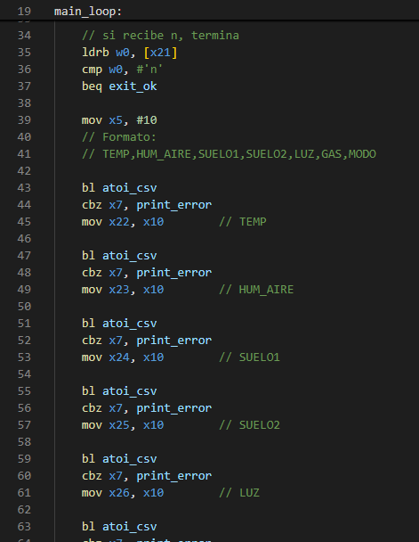

### 4.3 Motor ARM64 en Vivo

El motor ARM64 en vivo es el componente central de la Fase 2. Implementado en lenguaje ensamblador ARM64, este módulo:

- Recibe vía stdin una línea con los valores actuales de los sensores en el formato definido.
- Almacena la lectura en un historial interno de N lecturas (buffer circular en memoria).
- Calcula los tres indicadores requeridos: promedio reciente, tendencia acumulada y amplitud reciente.
- Aplica los indicadores por sensor para determinar el estado de cada variable monitoreada.
- Toma la decisión principal comparando el estado global contra los valores de referencia definidos.
- Retorna vía stdout la decisión tomada, los valores de los indicadores y la justificación de la decisión.
- Maneja errores de entrada inválida, valores no numéricos y casos de división por cero.


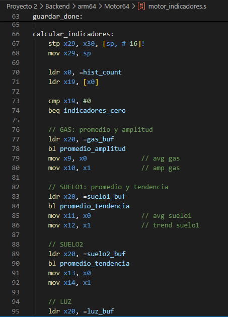
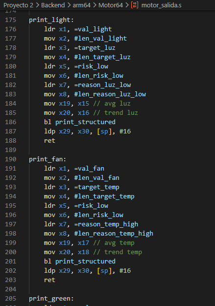
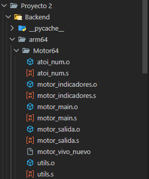
### 4.4 Analizador Histórico ARM64

El analizador histórico es el segundo componente ARM64 de la Fase 2. Recibe desde Python la ruta del archivo CSV, la línea inicial, la línea final y la columna del sensor a analizar. Sus responsabilidades son:

- Validar el rango de líneas (inicio < fin, ambas dentro del archivo, no vacías).
- Validar que la columna exista y contenga valores numéricos en el rango seleccionado.
- Calcular los cinco indicadores obligatorios: RMSE respecto al ideal, regresión lineal, predicción futura, integral del error por regla del trapecio y derivada suavizada.
- Retornar los resultados en el formato de salida definido para ser guardados por Python en MongoDB.

### 4.5 Capa de Datos — MongoDB Atlas

MongoDB Atlas almacena toda la información generada por el sistema. Las colecciones principales son:

| Colección | Propósito | Campos principales |
|---|---|---|
| `lecturas` | Historial de lecturas de sensores | timestamp, temperatura, humedad, luz, co2 |
| `decisiones` | Decisiones y justificaciones del motor ARM64 | timestamp, decision, indicadores, accion |
| `historico` | Resultados del analizador histórico | timestamp, sensor, rango, rmse, pendiente, prediccion, integral, derivada |

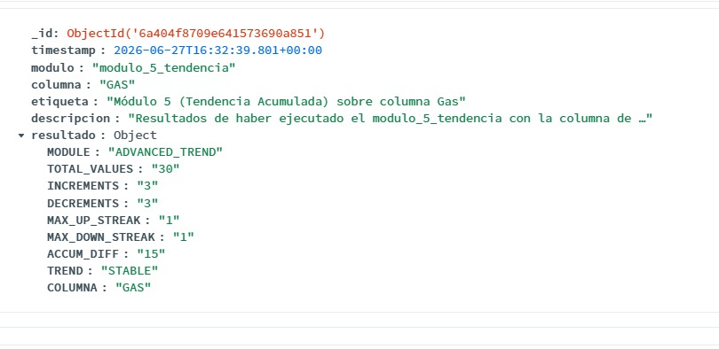

### 4.6 Visualización y Dashboard Web

#### 4.6.1 Grafana

Grafana se conecta a MongoDB Atlas (vía plugin o mediante una API intermedia) y muestra los siguientes paneles mínimos:

- Lecturas en tiempo real de temperatura, humedad, luminosidad y CO2.
- Histórico de decisiones ARM64 tomadas por el motor.
- Valores de indicadores: promedio reciente, tendencia y amplitud por sensor.
- Resultados del analizador histórico: RMSE, pendiente de regresión, predicción futura.

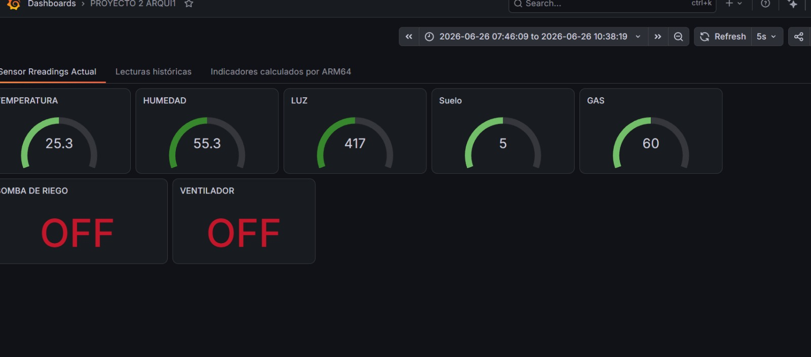
#### 4.6.2 Dashboard Web

El dashboard web es una aplicación web con las siguientes características:

- Autenticación básica mediante login (usuario y contraseña) para proteger rutas privadas.
- Visualización de lecturas actuales, decisiones ARM64, indicadores y resultados históricos.
- Datos provenientes del sistema real (MongoDB Atlas), no estáticos.
- Disponible mediante una URL pública para evaluación.

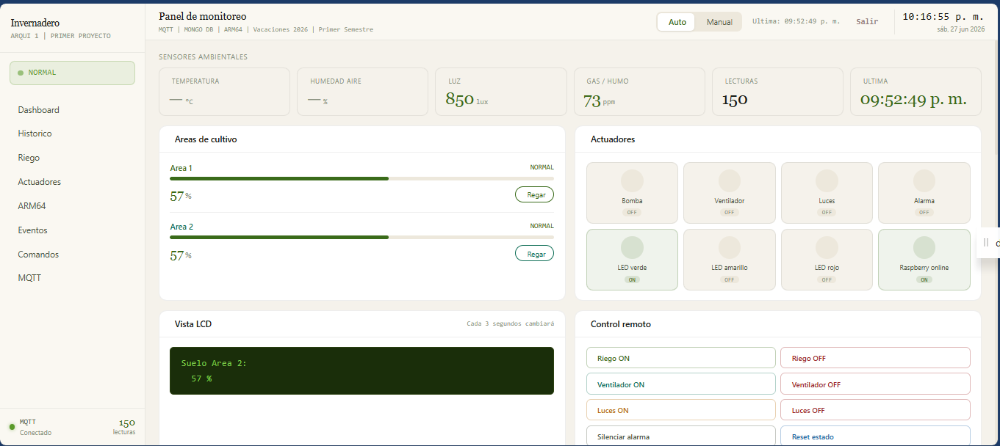
---

## 5. Módulos ARM64 por Integrante

Cada integrante del grupo desarrolló e implementó un módulo ARM64 propio. A continuación se describe cada módulo:

### 5.1 Módulo de [Dina Rebeca Perez]

**Modulo_1_rmse.s**

**Descripción:**
Esta rutina calcula qué tanto se aleja la variable analizada respecto a un valor ideal. 

**Pseudocódigo ARM64:**

**Validaciones implementadas:**


---

### 5.2 Módulo de [Oliverio Abraham Caal]

**Modulo_2_regresion.s**

**Descripción:**
Esta rutina calcula la tendencia general de la variable dentro de la ventana 
seleccionada. 
No acepta calcular la tendencia únicamente con el primer y último valor. 
**Pseudocódigo ARM64:**


**Validaciones implementadas:**


---

### 5.3 Módulo de [Tulio Jafeth Pirir] 

**Modulo_3_prediccion.s**

**Descripción:**
Esta rutina estima un valor futuro usando la recta calculada mediante regresión 
lineal. 
La predicción se realiza para K lecturas futuras. Si no se recibe K, podrá usarse K = 5.

**Pseudocódigo ARM64:**


**Validaciones implementadas:**

### 5.4 Módulo de [Astrid Vanessa Kim] 

**Modulo_4_integral_error.s**

**Descripción:**
Esta rutina calcula el error acumulado de la variable respecto a un valor ideal

**Pseudocódigo ARM64:**


**Validaciones implementadas:**

### 5.5 Módulo de [Angel Jose Cardenas] 

**Modulo_5_derivada_local.s**

**Descripción:**
Esta rutina calcula la velocidad de cambio local usando mini-ventanas internas de 5  puntos. 
No acepta calcular la derivada únicamente como resta entre dos puntos consecutivos. 

**Pseudocódigo ARM64:**


**Validaciones implementadas:**
---

## 6. Integración Python — ARM64

La comunicación entre Python y los módulos ARM64 se realiza mediante el mecanismo de stdin/stdout, donde Python actúa como proceso padre y ARM64 como proceso hijo.

### 7.1 Formato de entrada al motor en vivo

25,60,40,60,500,100,0
25,60,35,60,500,100,0
25,60,30,60,500,100,0
25,60,25,60,500,100,0
25,60,20,60,500,100,0

### 7.2 Formato de salida del motor en vivo

ACTION=RIEGO_1_ON 
TARGET=SOIL1 
RISK=HIGH 
REASON=SOIL_LOW_AND_DESCENDING 
VALUE=34 
INDICATOR=-6 
STATUS=OK

### 7.3 Manejo de errores

El motor ARM64 maneja los siguientes casos de error retornando códigos o mensajes estandarizados vía stdout:

- Entrada con formato inválido o campos faltantes.
- Valores no numéricos en los campos de sensores.
- División por cero en el cálculo de indicadores (buffer vacío o amplitud nula).
- Rango inválido en el analizador histórico (inicio >= fin, fuera de límites).
- Columna inexistente o con valores no numéricos en el archivo CSV.

---

## 8. Registro de Resultados y Visualización

### 8.1 Estructura de documentos en MongoDB

Ejemplo:
> ```json
> {
>   "timestamp": "2026-08-01T14:30:00Z",
>   "temperatura": 25.3,
>   "humedad": 68.1,
>   "luz": 820,
>   "co2": 412,
>   "decision": "RIEGO_ACTIVADO",
>   "promedio_temp": 24.8,
>   "tendencia_hum": -2.1,
>   "amplitud_luz": 150
> }
> ```

### 8.2 Conexión de Grafana
Grafana se conecta a una fuente de datos para este proyecto con MongoDB mediante un plugin y consulta la información almacenada.

### 8.3 Dashboard Web

El Dashboard Web es la aplicación con la que interactúa el usuario. A diferencia de Grafana, este si permite el monitoreo y el control del invernadero.


---

## 9. Manual de Uso y Ejecución

### 9.1 Requisitos previos

- Raspberry Pi 5 con Debian 13 ARM64.
- Python 3 con las librerías listadas en `requirements.txt`.
- Compilador ARM64: `gcc` o `as` (GNU Assembler).
- Broker MQTTX instalado y configurado.
- Cuenta y cluster en MongoDB Atlas con la base de datos configurada.
- Grafana instalado y configurado con la fuente de datos de MongoDB.


### 9.2 Compilación de módulos ARM64


> ```bash
> aarch64-linux-gnu-as -g -o motor_main.o motor_main.s
>aarch64-linux-gnu-as -g -o motor_indicadores.o motor_indicadores.s
>aarch64-linux-gnu-as -g -o motor_salida.o motor_salida.s
>aarch64-linux-gnu-ld -o motor_vivo_nuevo motor_main.o motor_indicadores.o motor_salida.o
> ```

### 9.3 Ejecución del sistema

1. Clonar el repositorio
2. Instalar dependencias Python: `pip install -r requirements.txt`
3. Compilar módulos ARM64
4. Configurar variables de entorno: `MONGODB_URI`, `MQTT_HOST`, etc.
5. Iniciar el broker MQTT
6. Ejecutar el orquestador principal (el backend): `python main.py`
7. Acceder al dashboard web


## 10. Pruebas y Evidencias

### 10.1 Pruebas del motor ARM64 en vivo

Se realizaron pruebas con entradas válidas e inválidas para verificar el correcto funcionamiento del motor:


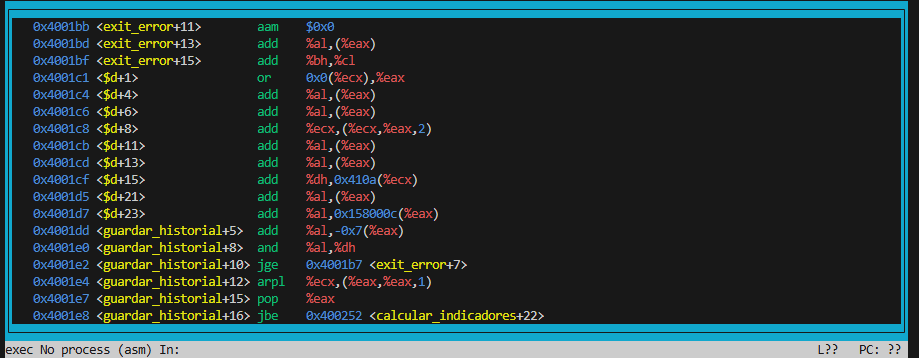
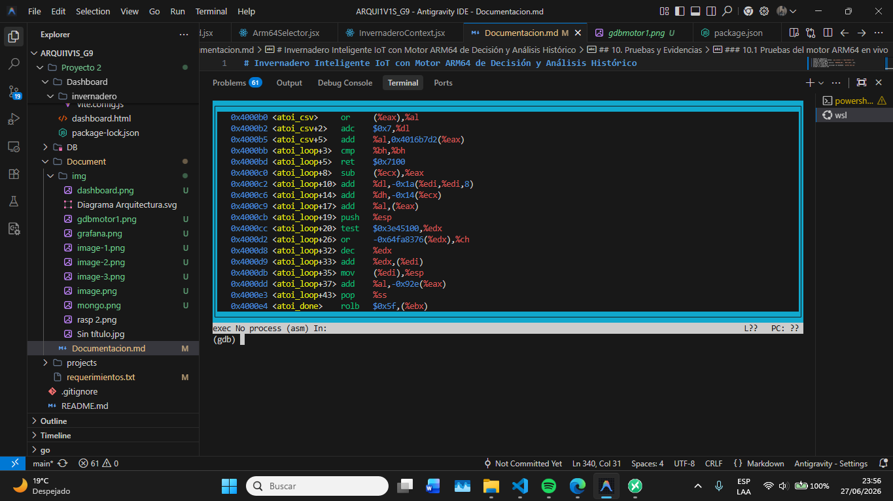
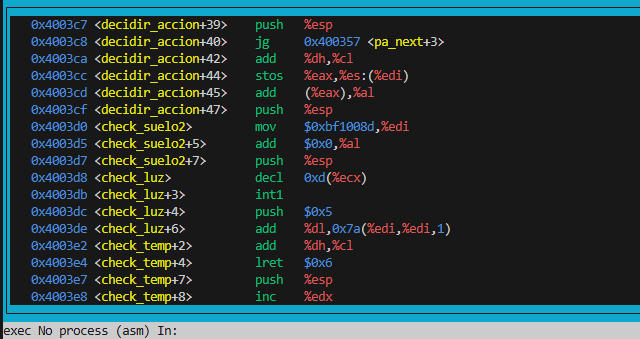
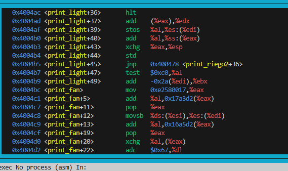

### 10.2 Evidencias de funcionamiento
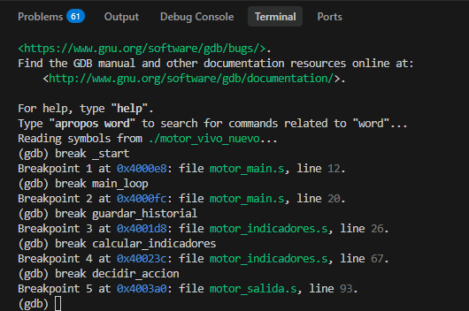
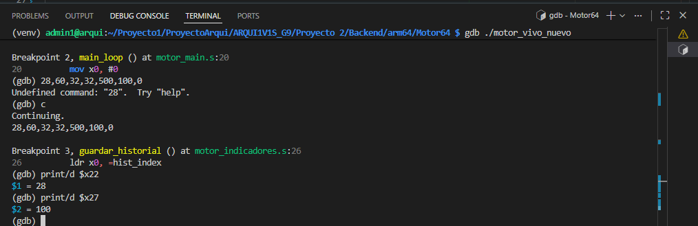

---


## 11. Conclusiones

Se armó un invernadero inteligente que combina sensores, actuadores, comunicación IoT y procesamiento de datos en una arquitectura distribuida. Gracias a la integración de Raspberry Pi, Python, ARM64, MongoDB, MQTT, Grafana y un Dashboard Web, se logró una solución práctica para monitorear y automatizar el invernadero.

Se añadieron módulos en ensamblador ARM64 para mover parte del procesamiento y análisis de datos fuera de Python. Esto mostró cómo la programación de bajo nivel puede aplicarse en sistemas embebidos reales y la importancia de repartir bien las tareas entre los distintos componentes.

Con MongoDB se guardó el historial de lecturas, eventos y resultados de los módulos ARM64, lo que permitió tener trazabilidad y luego mostrar todo de forma clara en Grafana y el Dashboard Web.

La comunicación por MQTT ayudó a separar el backend del dashboard, logrando un flujo de datos en tiempo real para monitoreo y control remoto, además de facilitar la integración entre los módulos del proyecto.

El Dashboard Web con login y los paneles de Grafana dieron una interfaz sencilla e intuitiva para ver el estado del invernadero, consultar datos históricos y visualizar los resultados generados por los módulos ARM64, mejorando la administración y el análisis.

---


## 12. Referencias

- ARM Limited. (2023). *ARM Architecture Reference Manual — ARMv8, for ARMv8-A architecture profile*. ARM Holdings.
- Raspberry Pi Foundation. (2023). *Raspberry Pi 4 Technical Specifications*. https://www.raspberrypi.com
- MongoDB, Inc. (2024). *MongoDB Atlas Documentation*. https://www.mongodb.com/docs/atlas/
- Eclipse Foundation. (2024). *Mosquitto MQTT Broker Documentation*. https://mosquitto.org/documentation/
- Grafana Labs. (2024). *Grafana Documentation*. https://grafana.com/docs/
