**Universidad San Carlos de Guatemala** **Facultad de Ingeniería** **Escuela de Ingeniería en Ciencias y Sistemas**
**Curso:** Arquitectura de Computadores y Ensambladores 1 (ACYE1)

**Auxiliar:** Diego Josue Guevara Abaj

# Invernadero Inteligente IoT

### Proyecto Fase 1

| Nombre                       | Carnet    |
| ---------------------------- | --------- |
| Dina Rebeca Pérez Bátres     | 202308200 |
| Ángel José Cárdenas Pocon    | 202304063 |
| Oliverio Abraham Caal Artola | 202303864 |
| Astrid Vanesa Kim Ortiz      | 202300685 |
| Tulio Jafeth Pirir Schuman   | 201700698 |

**Fecha:** Junio 2026

---

## Índice

1. Introducción
2. Objetivos
   2.1. Objetivo General
   2.2. Objetivos Específicos
3. Descripción del Sistema
   3.1. Arquitectura General y Subsistemas
   3.2. Flujo de Operación y Lógica de Control (Python)
   3.3. Persistencia de Datos y Comunicación MQTT
4. Equipo Utilizado y Presupuesto
5. Documentación Individual: Módulos ARM64
   5.1. Módulo 1: Media Aritmética Ponderada
   5.2. Módulo 2: Varianza y Desviación Estándar
   5.3. Módulo 3: Detección Estadística de Anomalías
   5.4. Módulo 4: Predicción Lineal Simple
   5.5. Módulo 5: Tendencia Acumulada Avanzada

---

## 1. Introducción

El presente documento detalla el diseño, la lógica y la implementación de un invernadero inteligente automatizado que integra hardware, software y comunicación IoT. El sistema está dividido físicamente en un área de cultivo y un centro de control operado por una Raspberry Pi.

Mediante el uso de Python para la capa de control, protocolos MQTT para la transmisión de telemetría y bases de datos NoSQL (MongoDB Atlas), la solución permite monitorear y controlar remotamente variables ambientales críticas como temperatura, humedad, luz y calidad del aire. Adicionalmente, el proyecto incluye un robusto análisis estadístico de los datos capturados operando a bajo nivel mediante rutinas escritas en lenguaje ensamblador ARM64.

## 2. Objetivos

### 2.1. Objetivo General

Diseñar e implementar un sistema IoT de automatización para un invernadero con un área de cultivo y un centro de control, integrando sensores, actuadores, MQTT, MongoDB y un dashboard web operado mediante una Raspberry Pi.

### 2.2. Objetivos Específicos

- Interpretar y gestionar variables físicas del entorno mediante pines GPIO y comunicación serial.
- Desarrollar scripts en Python que evalúen umbrales de seguridad para accionar bombas de riego, ventiladores e iluminación inteligente de forma autónoma.
- Estructurar el envío y almacenamiento de métricas y eventos de los actuadores usando MQTT y MongoDB.
- Desarrollar operaciones matemáticas y de dispersión estadística operando en arquitectura ARM64 sobre un archivo de 30 datos reales capturados por el sistema.

---

## 3. Descripción del Sistema

### 3.1. Arquitectura General y Subsistemas

El sistema opera bajo una arquitectura descentralizada donde la Raspberry Pi actúa como el nodo principal o cerebro (`main.py`). Se organiza en tres subsistemas de hardware principales:

1. **Sensores de Adquisición:** Lectura local de temperatura ambiental y humedad a través de un DHT11 conectado por GPIO a la Raspberry, respaldado por sensores LDR (luz), MQ135 (gas) y YL69 (humedad de suelo) administrados mediante comunicación Serial con un microcontrolador Arduino, utilizado como esclavo para poder hacer la conversión de analogo a digital necesaria para la conexión GPIO.
<table align="center">
  <tr>
    <td align="center">
      
      <br>
      <em>Figura 1: Sensor DHT11.</em>
    </td>
    <td align="center">
      
      <br>
      <em>Figura 2: Sensor LDR.</em>
    </td>
    <td align="center">
      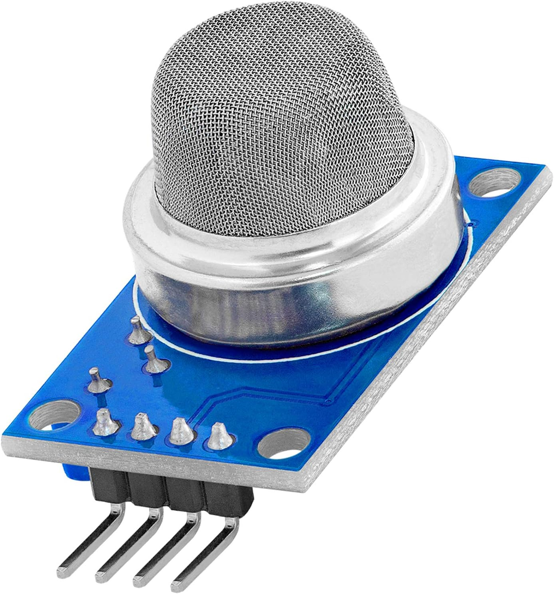
      <br>
      <em>Figura 3: Sensor MQ135.</em>
    </td>
    <td align="center">
      
      <br>
      <em>Figura 4: Sensor YL69.</em>
    </td>
    <td align="center">
      
      <br>
      <em>Figura 5: Arduino.</em>
    </td>
  </tr>
</table>

2. **Actuadores Mecánicos y Visuales:** Relés y transistores que conmutan el encendido de una bomba de agua, ventiladores de extracción y paneles LED, complementados por un centro de control físico con una pantalla LCD I2C y botones físicos.


3. **Red y Persistencia:** Broker `broker.emqx.io` y base de datos `MongoDB Atlas`.

### 3.2. Flujo de Operación y Lógica de Control (Python)

El núcleo del invernadero protege el estado global de condiciones de carrera utilizando la librería `threading` (bloqueo mutuo o `Lock`). La lógica evalúa ininterrumpidamente las lecturas del entorno:

```python
def aplicar_automatismos(lectura):
    if state["modo"] != "AUTOMATICO":
        # Prioridad de seguridad: Actúa sobre gas incluso en modo manual
        if lectura["gas"] >= UMBRAL_GAS_EMRG:
            set_ventilador(True, "gas_emergencia_override")
            set_alarma(True, "gas_emergencia_override")
        return

    # Extracción de calor autónoma
    if lectura["temp"] >= UMBRAL_TEMP_ALTA:
        set_ventilador(True, "temperatura_alta")

    # Riego controlado y protegido
    if lectura["suelo1"] < UMBRAL_SUELO_SECO and not state["riego1"]:
        activar_riego(1, True, "suelo_seco_auto")

```

- **Interpretación del Código:** La función garantiza que el sistema actúe frente a caídas de humedad o picos térmicos. Al ejecutar `activar_riego()`, la bomba no queda encendida indefinidamente, sino que se delega un hilo asíncrono (`threading.Timer`) configurado para apagar el actuador tras 10 segundos, previniendo riesgos eléctricos y ahogamiento de cultivos.

Para conectar la capa de alto nivel (Python) con la capa de bajo nivel (Ensamblador), el sistema mantiene un búfer rotativo de lecturas:

```python
def acumular_csv(lectura):
    with state["lock"]:
        state["lecturas_csv"].append(fila)
        # Búfer circular estricto de 30 registros
        if len(state["lecturas_csv"]) > 30:
            state["lecturas_csv"].pop(0)
        if len(state["lecturas_csv"]) >= 30:
            _escribir_csv()

```

### 3.3. Persistencia de Datos y Comunicación MQTT

Los datos generados se envían estructurados mediante **MQTT** para asegurar la entrega. Paralelamente, el script `base_datos.py` formatea colecciones en MongoDB bajo dos enfoques:

- **Series de Tiempo (`sensor_readings`):** Se usa la operación de actualización `$push` dentro de un mismo bloque de día (`fecha_dia`). Esto agrupa métricas masivas, lo que reduce el coste computacional cuando el Dashboard web grafica el historial.
- **Caché Caliente (`system_status`):** Emplea un solo documento `_id: "greenhouse_state"`, actualizado in-place mediante `$set`, para brindar telemetría en tiempo real de forma inmediata.

---

## 4. Equipo Utilizado y Presupuesto Estimado

El siguiente cuadro detalla los recursos materiales implementados en el montaje físico del sistema, incluyendo costos reales de componentes críticos adquiridos.

| Componente                                  | Categoría     | Cant. | Costo U. (Q) | Total (Q)       |
| ------------------------------------------- | ------------- | ----- | ------------ | --------------- | 
| Raspberry Pi 5                              | Procesamiento | 1     | 3,818.00     | 3,818.00        | 
| Sensor DHT11                                | Sensor        | 1     | 30.00        | 30.00           |
| Sensor Humedad Suelo LY-69                  | Sensor        | 1     | 25.00        | 25.00           |
| Módulo LDR Fotorresistencia                 | Sensor        | 1     | 18.00        | 18.00           |
| Módulo ADC 16Bits ADS1115                   | Hardware      | 1     | 60.00        | 60.00           |
| Sensor MQ-2 / MQ-135                        | Sensor        | 1     | 40.00        | 40.00           | 
| Bomba de agua (Mini)                        | Actuador      | 1     | 50.00        | 50.00           | 
| Ventilador DC / Extractor                   | Actuador      | 1     | 35.00        | 35.00           | 
| Pantalla LCD I2C                            | Interfaz      | 1     | 60.00        | 60.00           | 
| Componentes menores (Buzzer, LEDs, Botones) | Varios        | -     | -            | 42.00           | 
| Materiales maqueta y cableado               | Varios        | 1     | 150.00       | 150.00          | 
| **TOTAL**                                   |               |       |              | **Q. 3,909.00** |

---

## 5. Documentación Individual: Módulos ARM64

Para integrar los cálculos, el archivo `arm64_runner.py` emplea un subproceso (`subprocess.run([bin_path, str(indice)])`) enviando como argumento de terminal el índice numérico que el ensamblador debe procesar en la matriz de `lecturas.csv`. Todas las rutinas procesan un lote de 30 datos haciendo uso de una biblioteca común `utils.s`.

### 5.1. Módulo 1: Media Aritmética Ponderada

**Nombre:** Dina Rebeca Pérez Bátres

**Carnet:** 202308200

- **Explicación del Algoritmo:** Este módulo lee el conjunto de datos dinámicos y procesa la media ponderada mediante la fórmula $MEDIA\_PONDERADA = \frac{\sum (X_i \cdot W_i)}{\sum W_i}$. El peso aumenta progresivamente de 1 a 30 por cada iteración.
- **Manejo de Argumentos y Registros:** Utiliza el puntero de pila (`ldr x0, [sp]`) para extraer `argv[1]`, lo convierte a entero con la función `parse_int` y lo protege en el registro `x28`. Así, el binario procesa la columna solicitada por Python sin codificar el índice en duro. `x20` acumula la suma total y `x21` la sumatoria de pesos.
- **Ciclos, Saltos y Subrutinas:** Emplea `loop_lectura` condicionado a finalizar cuando el contador llegue a 30. En cada lectura efectúa una multiplicación sin signo del valor por el peso (`mul x25, x23, x24`) sumando el producto acumulado. Tras salir del ciclo, la etiqueta `calcular_media` efectúa una división entera final (`udiv x26, x22, x21`).
- **Formato de Salida:** Escribe internamente a `resultado_media.txt` entregando `SUM_X`, `WEIGHT_SUM` y `WEIGHTED_MEAN`.
- **Evidencia de Depuración:** 
<table align="center">
  <tr>
    <td align="center">
      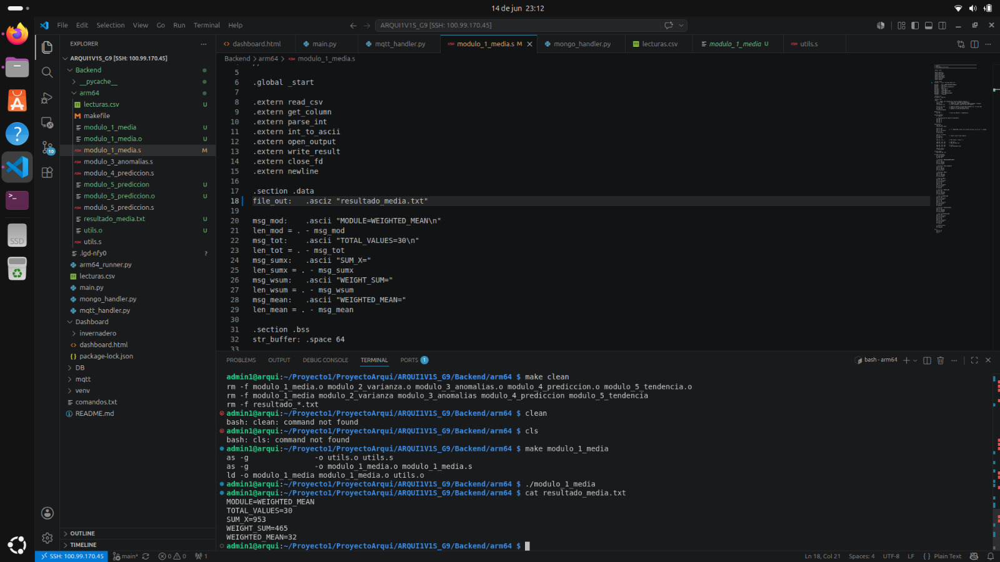
    </td>
    <td align="center">
      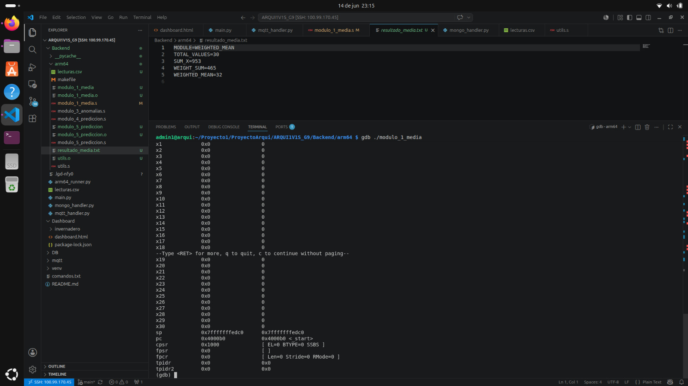
    </td>
    <td align="center">
      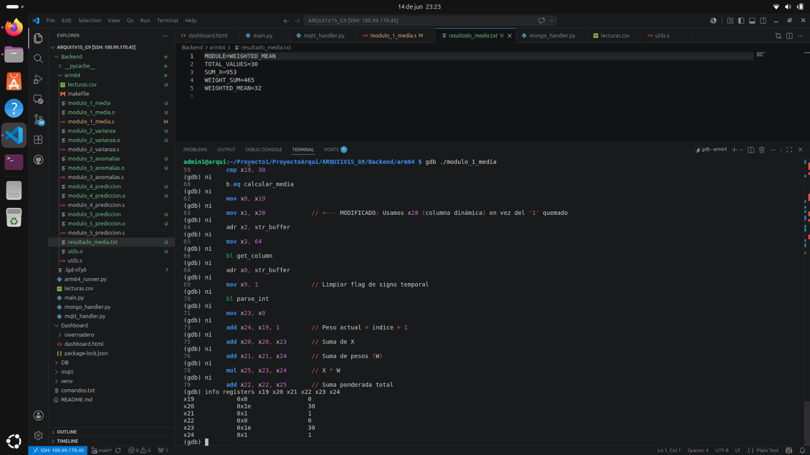
    </td>
  </tr>
</table>

### 5.2. Módulo 2: Varianza y Desviación Estándar

**Nombre:** Oliverio Abraham Caal Artola

**Carnet:** 202303864

* **Explicación del Algoritmo:** Estima la dispersión de las lecturas. Primero calcula la media aritmética, luego acumula la suma de las diferencias al cuadrado respecto a la media ($VARIANZA = \frac{\sum (X_i - MEDIA)^2}{N}$) y finalmente extrae la raíz cuadrada entera para obtener la Desviación Estándar.
* **Manejo de Registros y Ciclos:** Utiliza iteradores secuenciales (`suma_loop` y `sumsq_loop`). `x19` almacena la Media calculada y `x20` funciona como acumulador de las diferencias al cuadrado. Para la desviación estándar, hace un llamado a la subrutina propia `raiz_entera`, la cual implementa el método matemático iterativo de **Newton-Raphson** (usando `x19` y `x20` internamente en `raiz_loop` hasta que el valor converja).
* **Formato de Salida:** Genera el archivo `resultado_varianza.txt` exponiendo los valores tabulados de `TOTAL_VALUES`, `MEAN`, `VARIANCE` y `STD_DEV`.
* **Evidencia de Depuración:** 
<table align="center">
  <tr>
    <td align="center">
      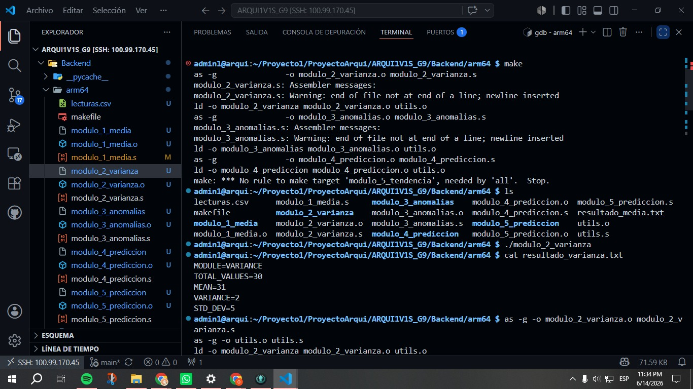
    </td>
    <td align="center">
      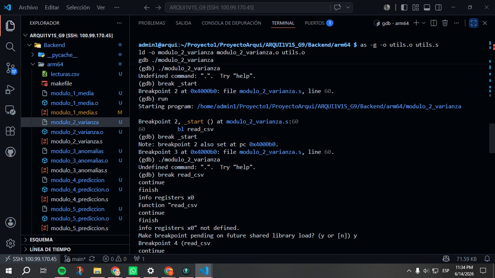
    </td>
    <td align="center">
      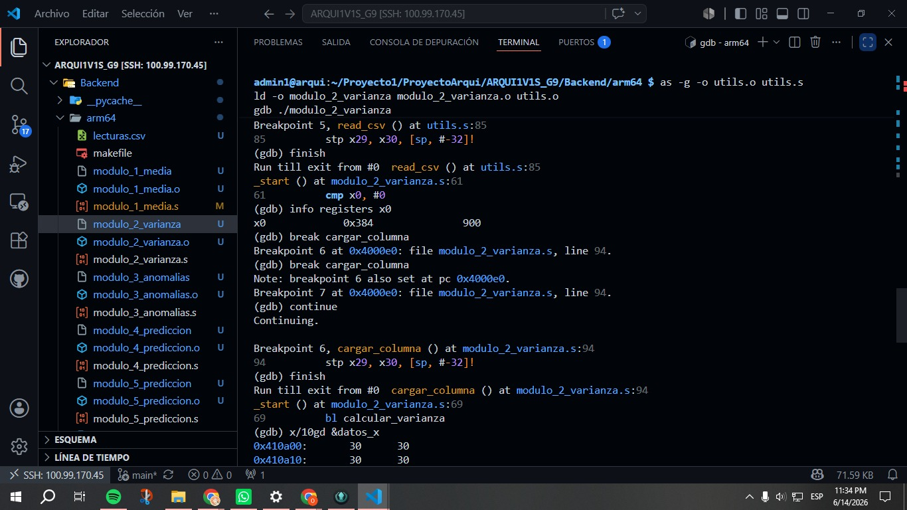
    </td>
    <td align="center">
      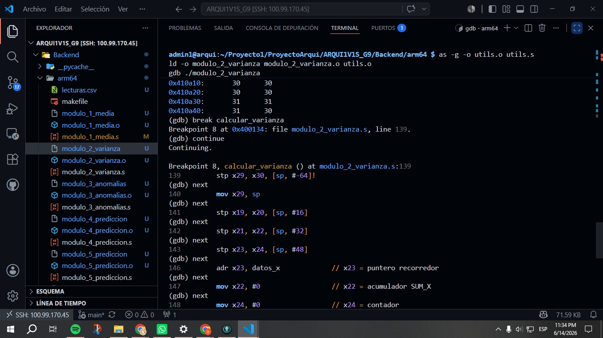
    </td>
    <td align="center">
      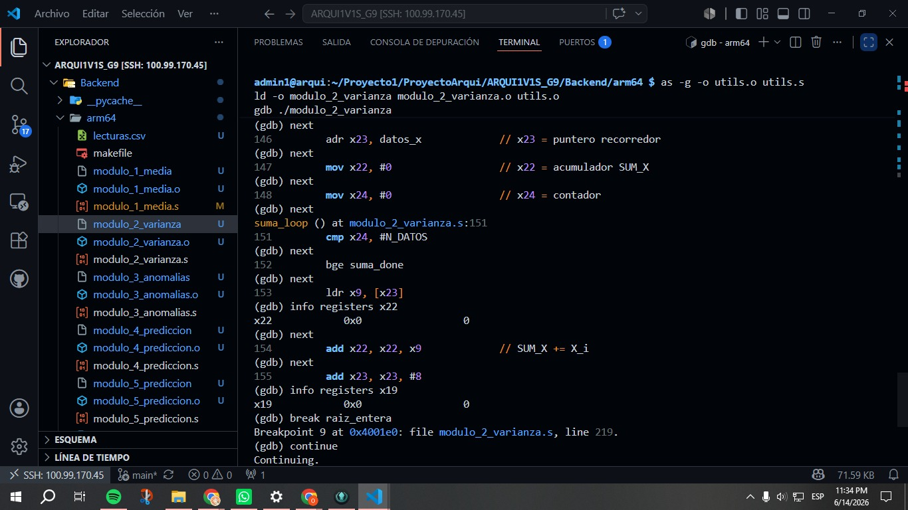
    </td>
    <td align="center">
      
    </td>
  </tr>
</table>

### 5.3. Módulo 3: Detección Estadística de Anomalías

**Nombre:** Tulio Jafeth Pirir Schuman

**Carnet:** 201700698

* **Explicación del Algoritmo:** Implementa la búsqueda de fallos calculando el puntaje Z ($Z-score$). Si el valor absoluto ($|Z| \ge 2$), el registro se cataloga como anomalía. Dependiendo de la sumatoria de anomalías, clasifica el sistema como NORMAL (0), MEDIUM (1-3) o HIGH (>=4).
* **Manejo de Registros, Hardware FPU y Ciclos:** Destaca por utilizar la unidad de punto flotante por hardware (FPU) para extraer la raíz cuadrada exacta. Carga el entero de varianza en el registro de 64-bits `d0` con `scvtf`, ejecuta la instrucción nativa `fsqrt d0, d0`, y lo devuelve a entero con truncado a cero (`fcvtzs x25, d0`). Emplea la subrutina `z_score_loop` para iterar y contabilizar anomalías en el registro `x26`.
* **Formato de Salida:** Cuenta con un bloque de impresión dual que plasma los resultados (`ANOMALIES` y `SYSTEM_RISK`) de forma síncrona tanto en Consola (stdout) como en el archivo físico `resultado_anomalias.txt`.
* **Evidencia de Depuración:** 
<table align="center">
  <tr>
    <td align="center">
      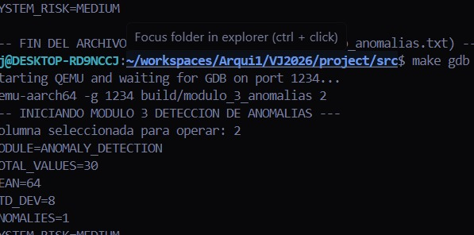
    </td>
    <td align="center">
      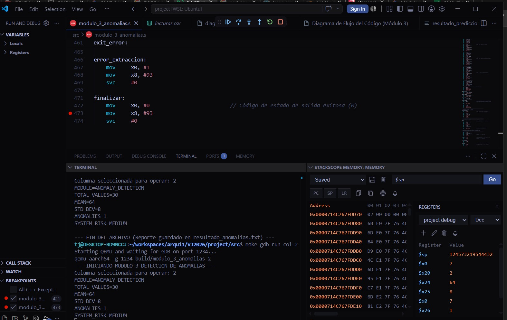
    </td>
    <td align="center">
      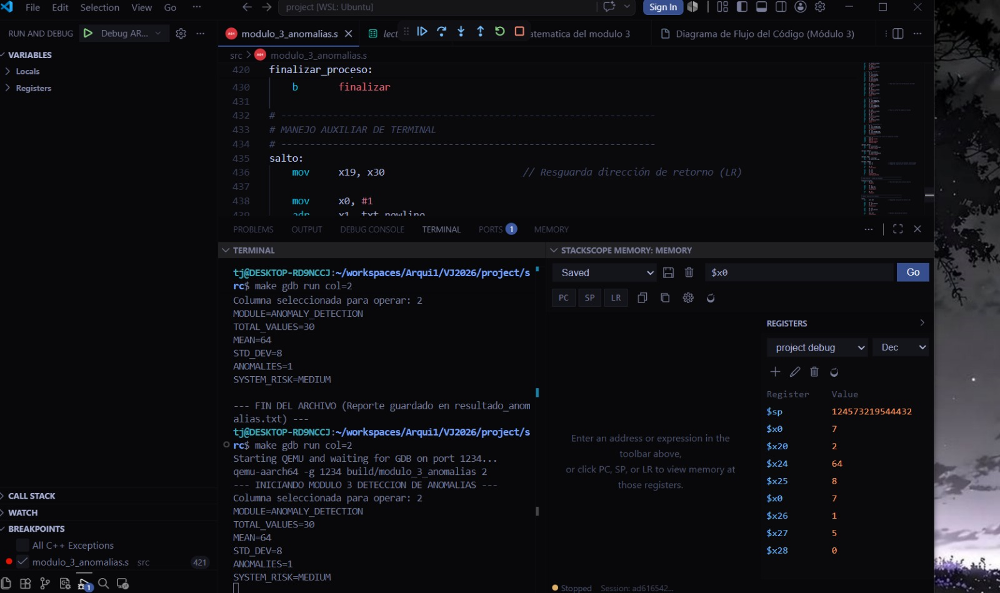
    </td>
    <td align="center">
      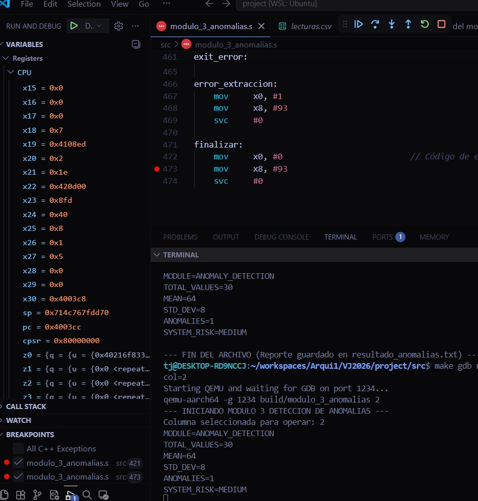
    </td>
    <td align="center">
      
    </td>
  </tr>
</table>

### 5.4. Módulo 4: Predicción Lineal Simple

**Nombre:** Astrid Vanesa Kim Ortiz

**Carnet:** 202300685

* **Explicación del Algoritmo:** Implementa la búsqueda de fallos calculando el puntaje Z ($Z-score$). Si el valor absoluto ($|Z| \ge 2$), el registro se cataloga como anomalía. Dependiendo de la sumatoria de anomalías, clasifica el sistema como NORMAL (0), MEDIUM (1-3) o HIGH (>=4).
* **Manejo de Registros, Hardware FPU y Ciclos:** Destaca por utilizar la unidad de punto flotante por hardware (FPU) para extraer la raíz cuadrada exacta. Carga el entero de varianza en el registro de 64-bits `d0` con `scvtf`, ejecuta la instrucción nativa `fsqrt d0, d0`, y lo devuelve a entero con truncado a cero (`fcvtzs x25, d0`). Emplea la subrutina `z_score_loop` para iterar y contabilizar anomalías en el registro `x26`.
* **Formato de Salida:** Cuenta con un bloque de impresión dual que plasma los resultados (`ANOMALIES` y `SYSTEM_RISK`) de forma síncrona tanto en Consola (stdout) como en el archivo físico `resultado_anomalias.txt`.
* **Evidencia de Depuración:** 
<table align="center">
  <tr>
    <td align="center">
      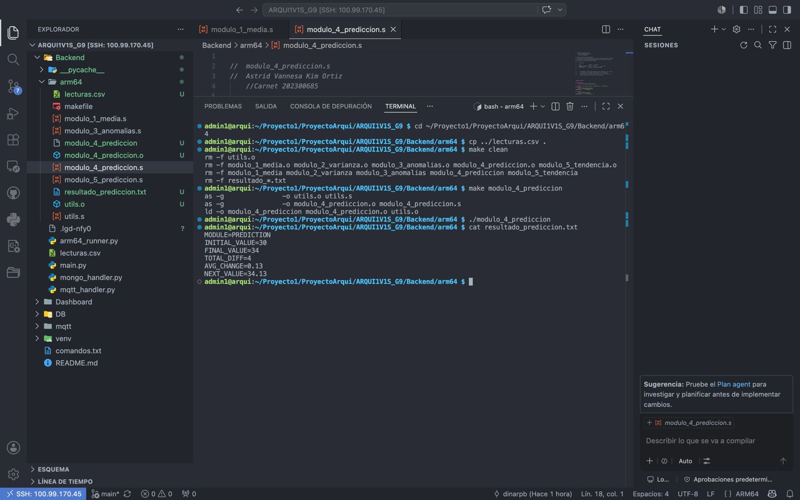
    </td>
    <td align="center">
      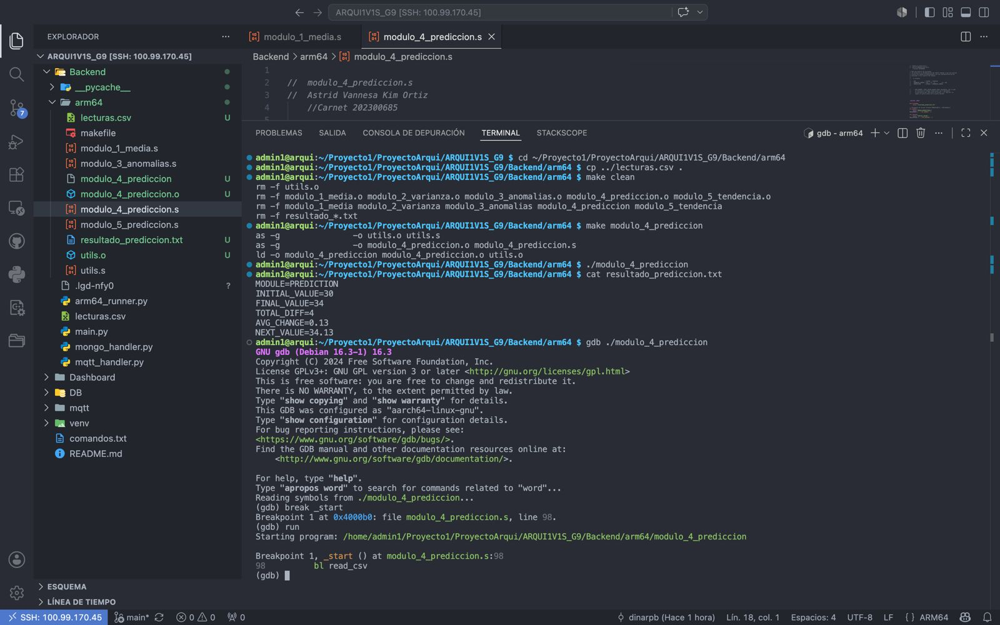
    </td>
    <td align="center">
      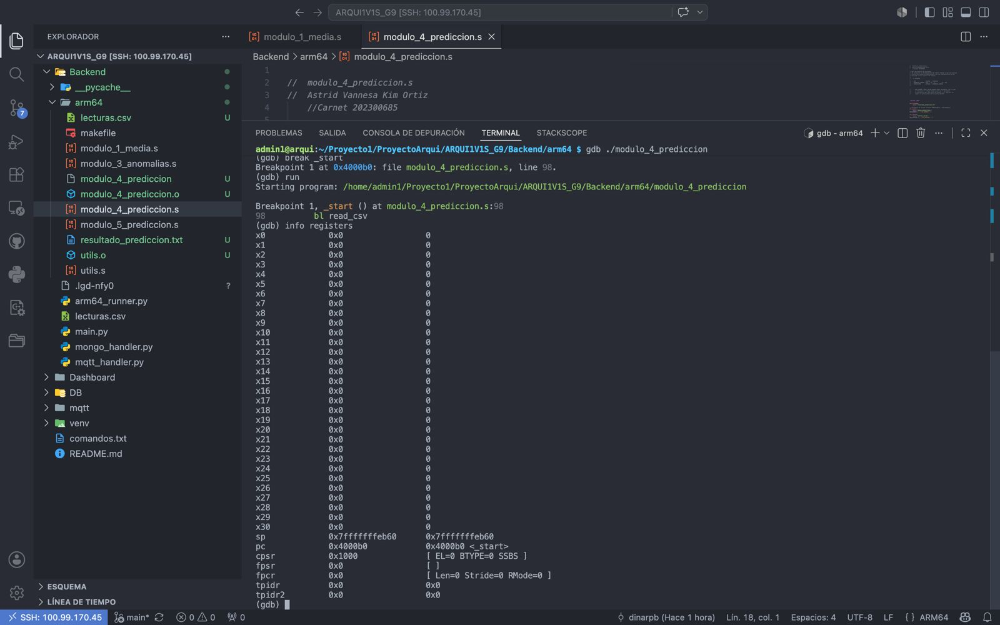
    </td>
    <td align="center">
      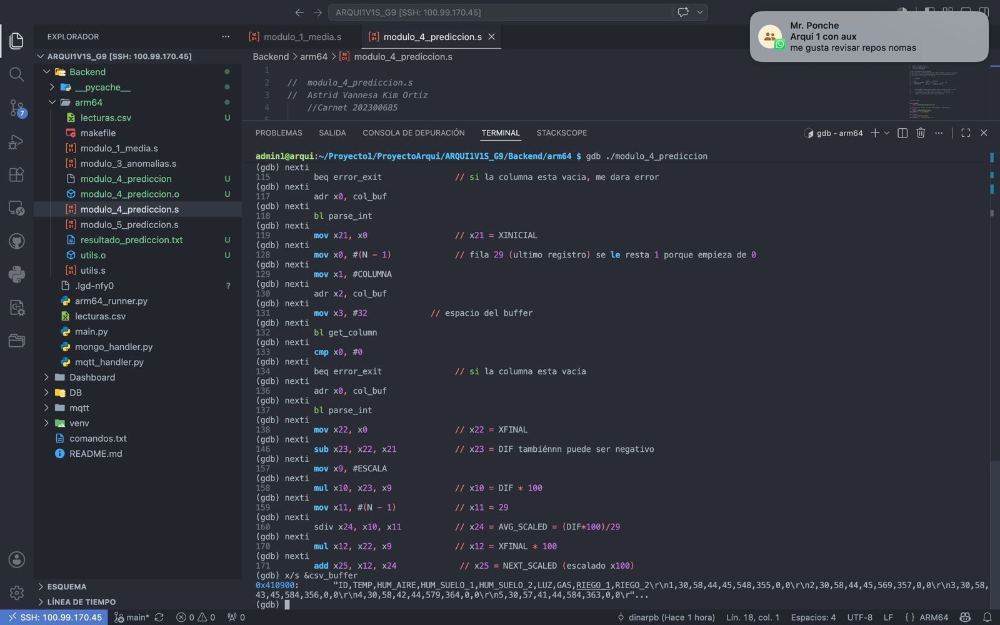
    </td>
    <td align="center">
      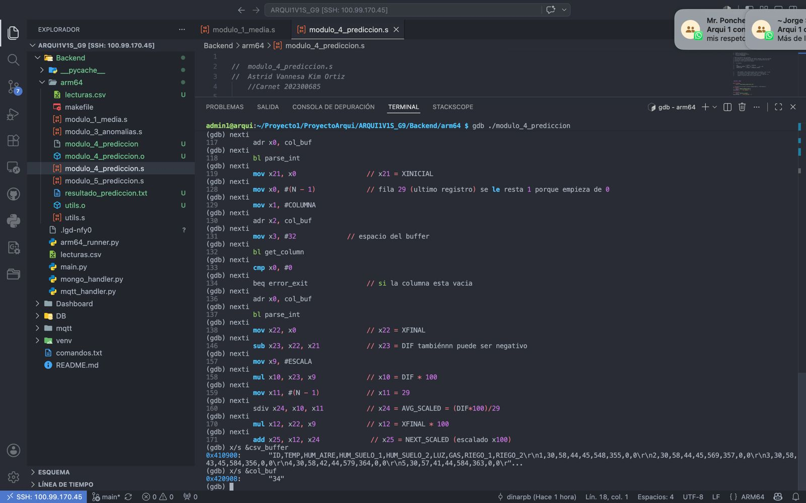
    </td>
    <td align="center">
      
    </td>
  </tr>
</table>

### 5.5. Módulo 5: Tendencia Acumulada Avanzada

**Nombre:** Ángel José Cárdenas Pocon

**Carnet:** 202304063

* **Explicación del Algoritmo:** Mide las fluctuaciones sucesivas ($X_i - X_{i-1}$) para obtener la cantidad de incrementos, decrementos y las rachas ininterrumpidas máximas de crecimiento y caída. Define la tendencia global evaluando el valor de la diferencia acumulada ($DIF\_ACUM$).
* **Manejo de Registros y Ciclos:** Implementa el ciclo `calc_loop` utilizando bifurcaciones (`trend_increment` y `trend_decrement`). Mantiene múltiples contadores simultáneos: `x21` (incrementos totales), `x22` (decrementos totales), `x23` (diferencia acumulada), `x24` y `x25` (rachas actuales), actualizando las rachas históricas máximas en los registros `x26` y `x27`. Si la diferencia es igual, reinicia las rachas a 0 automáticamente.
* **Formato de Salida:** Retorna los 5 indicadores procesados y concatena la etiqueta textual correspondiente (UP, DOWN, o STABLE) en el archivo `resultado_tendencia.txt`.
* **Evidencia de Depuración:** 
<table align="center">
  <tr>
    <td align="center">
      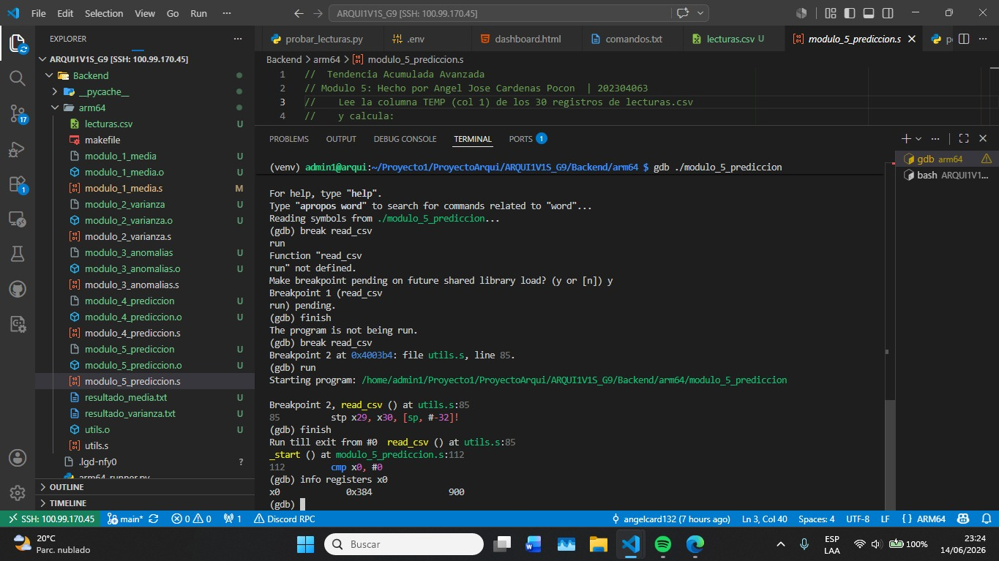
    </td>
    <td align="center">
      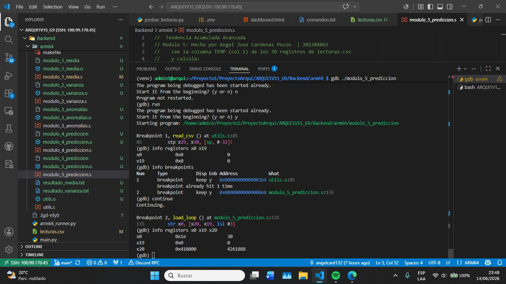
    </td>
    <td align="center">
      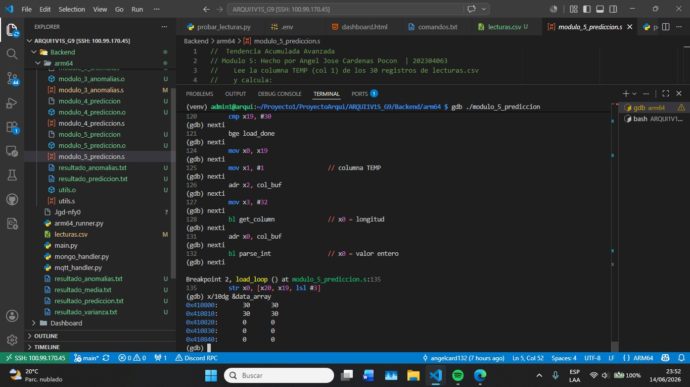
    </td>
  </tr>
</table>

# 6. Anexos
Aquí se documentan fotografías del proceso de la maqueta y circuitos electronicos utilizados para el proyecto, en el que se puede evidenciar el trabajo de los cinco integrantes del equipo.

<table align="center">
  <tr>
    <td align="center">
      
    </td>
    <td align="center">
      
    </td>
    <td align="center">
      
    </td>
    <td align="center">
      
    </td>
    <td align="center">
      
    </td>
  </tr>
  <tr>
    <td align="center">
      
    </td>
    <td align="center">
      
    </td>
    <td align="center">
      
    </td>
    <td align="center">
      
    </td>
    <td align="center">
      
    </td>
  </tr>
  <tr>
    <td align="center">
      
    </td>
    <td align="center">
      
    </td>
    <td align="center">
      
    </td>
    <td align="center">
      
    </td>
    <td align="center">
      
    </td>
  </tr>
</table>
